# Booking System


Online booking for small businesses like a barbershop, a clinic or a nail salon: the business sets up its services and opening hours, and clients pick a free time.

Try it: **[booking-system-j7po.onrender.com](https://booking-system-j7po.onrender.com)**, a made-up barbershop. The staff side is at `/admin.html` and its login is shown there. It's a free instance, so the first visit after a while can take up to a minute.

Building a form that saves a date is easy. The hard part is the rules: two clients can't get the same time, a 30 minute haircut can't start at 11:45 if lunch is at 12:00, the barber needs 10 minutes to clean up between clients, nobody can book for 5 minutes from now. That's the part I wanted to get right first, then the API and the page on top of it.


Work in progress. What works today: the rules, a REST API on PostgreSQL, the client's booking page and a staff page with login, and cancelling. More than one professional comes next.

## The booking page

Pick a service, a day, a time, write your name and phone, done. Each day shows how many times are still free, so a client doesn't click through full days. Times are split into morning, afternoon and evening.

With more than one barber there's a "With" row above the days: *whoever is free*, or one of them by name. Picking one shows only their times. With *whoever is free*, a time shows up when at least one of them has it, and the booking goes to whoever has the fewest clients that day, so the work gets spread instead of always landing on the first name.

If someone else takes the same time while the page is open, the booking is refused, the list of times is reloaded and the page says what happened, keeping the name and phone already typed:


It's plain HTML, CSS and JS served by Spring (`src/main/resources/static`), no build step. Follows the system's dark mode and works on a phone, where the days become a strip you swipe sideways.

<p>
  
  
</p>

## Reminding the day before

Each booking still to come has a **Remind** link on the agenda. It opens WhatsApp with the message already written (*"Hi Lucas! A reminder from Northside Barbers: Haircut and beard with Caio tomorrow at 10:30, Rua dos Pinheiros 412. If you can't make it, just reply here."*) and the agenda marks it as reminded, with the time, so the next person at the desk doesn't send it twice. A booking that moves to another time loses the mark and needs a new reminder. Nothing is sent by the system: no SMS bill, no WhatsApp Business API, the staff presses send from their own phone.

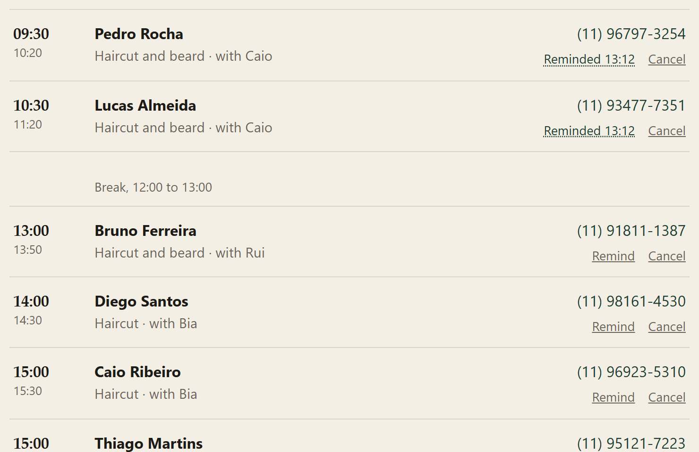

## When the day is full

A full day isn't a dead end. It still opens, says there are no times left, and offers the waiting list: a name and a phone, and the client gets their place in the line back. Asking twice with the same phone keeps the first place.

Nothing gets sent by the system, on purpose: a barbershop doesn't need an email server, it needs someone to call. The staff sees who's waiting under that day's agenda, first in line first, with the service and the person they asked for, a phone to tap and a WhatsApp link. When someone cancels, they call the first one.

<p>
  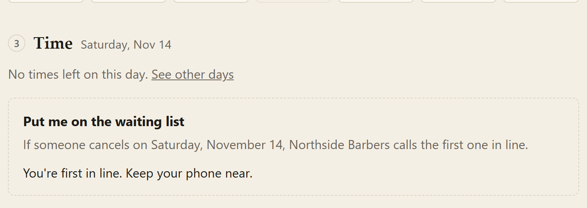
  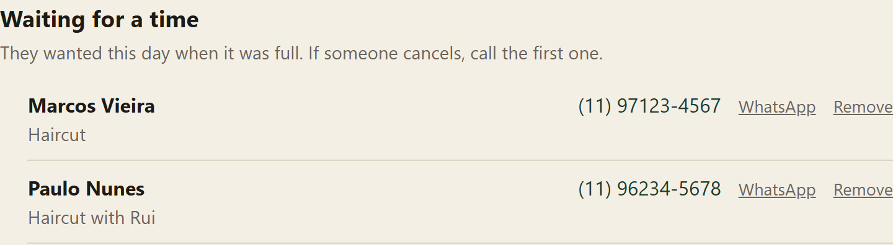
</p>

## Changing or cancelling

The confirmation shows a link the client keeps. It opens a page with the booking, a button to pick another time and one to cancel, up to 3 hours before the time (`booking.cancel-until`). After that the page says to call instead, and the staff can still cancel from their side at any time.

<p>
  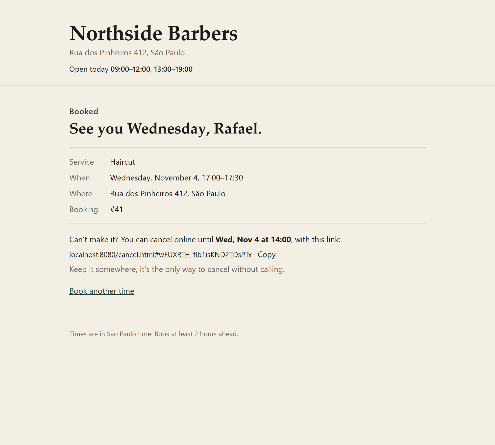
  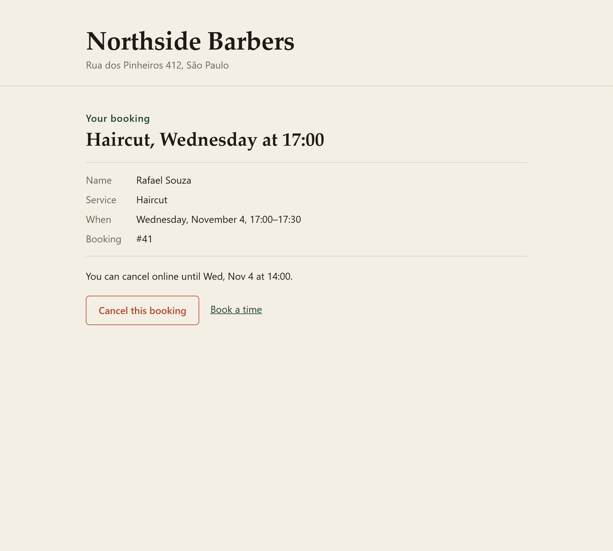
</p>

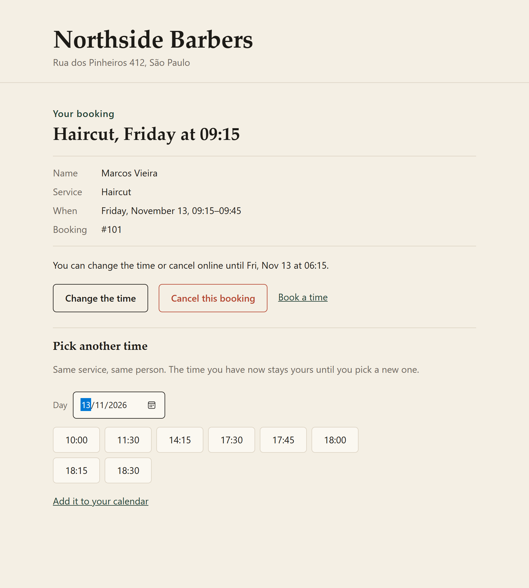

- The link has a random 24 character token. The database keeps only its SHA-256, so a leaked backup can't be used to cancel other people's bookings.
- The token goes after the `#` in the link. Browsers never send that part to a server, not even in the Referer to another site, so it stays out of server logs.
- Bookings can't be read by id anymore (`/api/bookings/1`, `/2`, `/3`... would let anyone walk through the clients' names). Only by the token.
- **Another time** keeps the same service and the same person, and it's the same booking: one `UPDATE` with the new times, so the link, the number and the calendar event stay the same. The new time goes through every rule a new booking does, and the overlap constraint checks it in the database. The booking's old time doesn't get in the way of its new one (10:00 to 10:30 overlaps, and that's fine), and until a new time is picked the old one stays the client's.
- **Add it to your calendar** downloads an `.ics` file that Google Calendar, Apple and Outlook open, with a reminder the day before and one an hour before. Times are in UTC inside the file, so no calendar has to know São Paulo's timezone rules, and the event id is the booking's, so importing it again after moving updates the event instead of adding a second one.
- Cancelling is an `UPDATE ... WHERE status = 'CONFIRMED'`, so two clicks at the same moment can't both cancel, and the time is free again right away (the overlap constraint only looks at confirmed bookings).

## The staff side

`/admin.html` is where the barber logs in and sees the day: each booking with the client's phone (a tap calls it on the phone), and the free time between them, so it's easy to see where a walk-in fits. Cancelled bookings show up at the end, saying who cancelled and when.

<p>
  
  
</p>

The other two tabs are for setting things up: services (name, duration, the clean-up time after, price, and whether clients can see it) and the week's opening hours, where a day can have more than one stretch and the gap between them is the break. Two stretches that overlap are refused.

The last tab is for days off: a special date (closed, or open at other hours, like a short Christmas Eve) and time away during a day (the dentist at 14:00). Clients stop seeing those times right away. Bookings that were already made aren't moved or cancelled behind anyone's back: the page says how many are in the way, and the agenda marks them so the staff can call those clients.

With a team, time away is for one person or for the whole place, and the agenda has a row to see everyone's bookings (each with the barber's name) or one person's day with their free gaps. The team itself is on the services tab: add someone, rename, pick which services they do (nothing picked means all of them, so a new barber who doesn't color yet just isn't offered for coloring), or turn off whoever left (their old bookings keep their name).

Each person can also have their own week. Bia only works afternoons, Tuesday to Saturday: tick her days and the hours, and that's what clients see when they pick her. "Whoever is free" also leaves her out on a Monday morning. Her hours sit inside the place's, never past them, so a holiday still closes the place for everyone and the lunch break still applies. Someone with no hours of their own works whenever the place is open, like before.

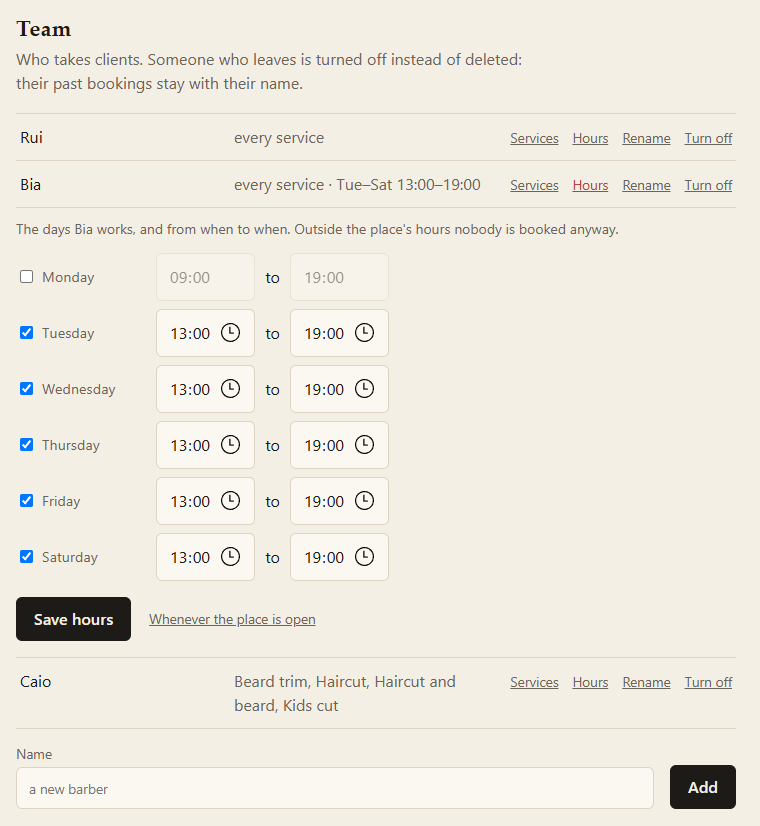

<p>
  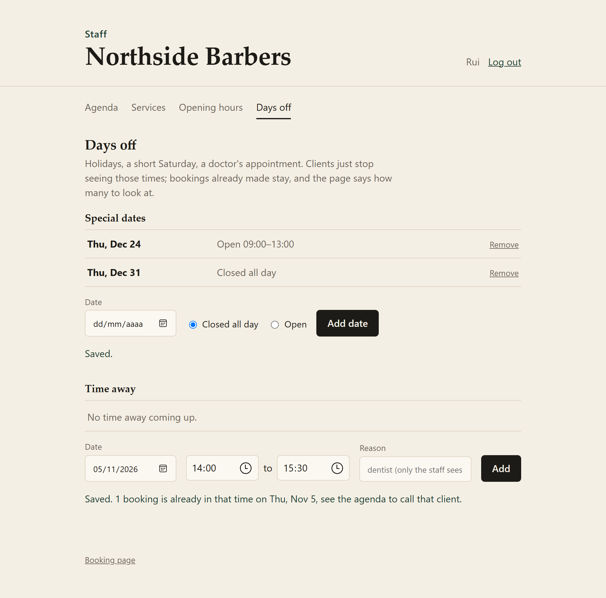
  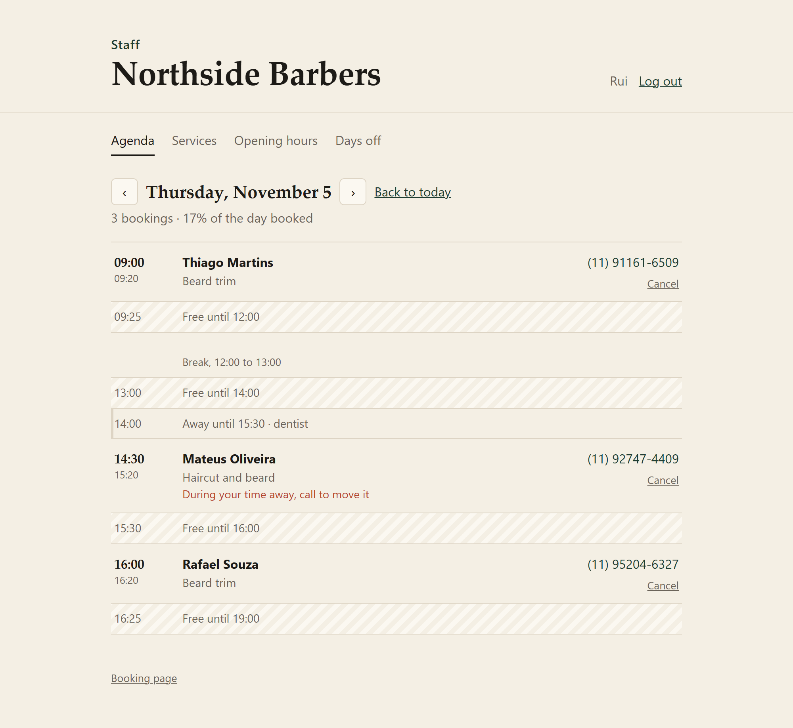
</p>

<p>
  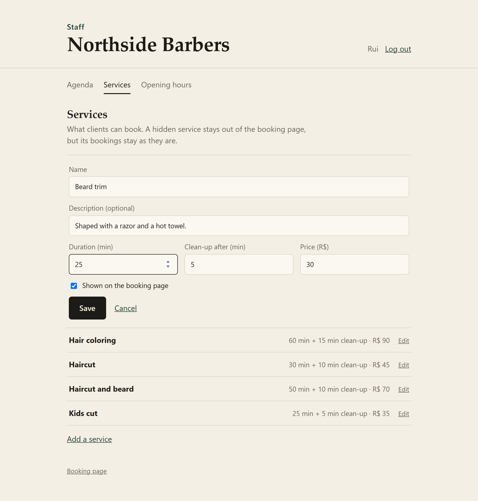
  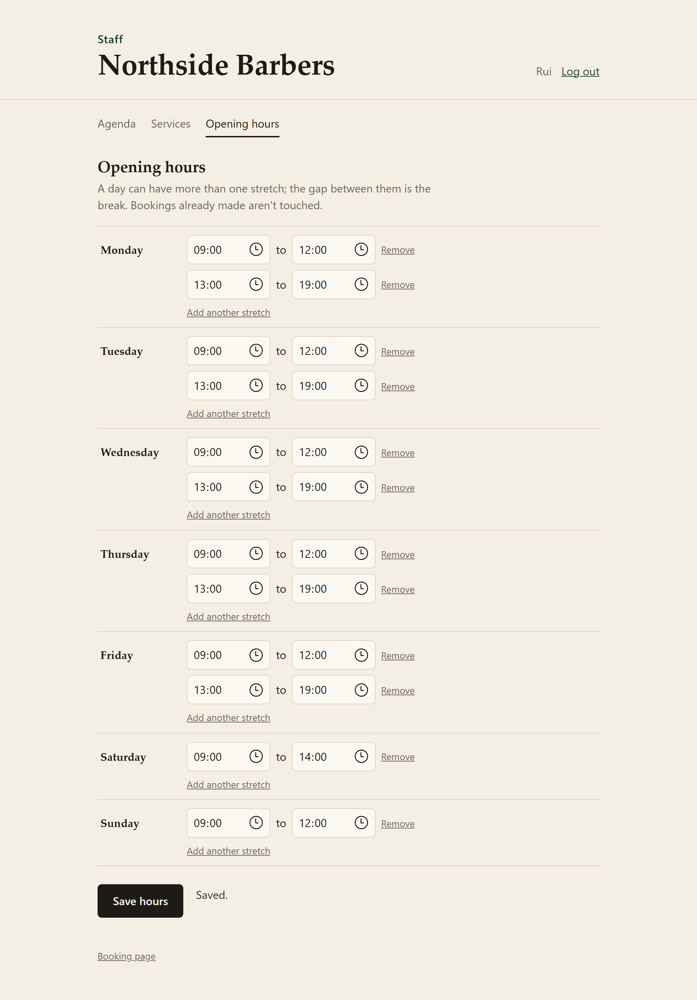
</p>

How the login works:

- E-mail and password, checked against a bcrypt hash. The answer is the same for an unknown e-mail and a wrong password, so the login can't be used to find out who works there.
- After logging in, the browser gets a session cookie marked `HttpOnly` (a script on the page can't read it) and `SameSite=Strict`. The session id changes at login, so an id planted before doesn't work after.
- Since the browser sends that cookie by itself, every change also needs a CSRF token: it comes in the `XSRF-TOKEN` cookie and the page sends it back in a header. Another site can make the browser send the cookie, but it can't read the token. The client's booking doesn't need it, there's no session there to abuse.
- 5 wrong passwords for the same e-mail lock that e-mail for 15 minutes. Other people can still log in.
- There's no default password. The first login is created from `OWNER_EMAIL` and `OWNER_PASSWORD` (at least 10 characters) when the staff table is empty; without them the app starts with no admin and says so in the log.

I went with a session instead of a JWT because the page and the API are on the same site: a cookie the page can't touch is safer than a token stored in JavaScript, and logging out actually ends the session on the server.

## On a phone and with a keyboard

- Most clients book from a phone, so every page, the staff ones too, fits a 375px screen.
- Fields are 16px so iOS doesn't zoom in, and the small Cancel, Edit and Hours buttons have a finger-sized hit area.
- The service and person pickers are radio groups: Tab gets in, the arrow keys move between options.
- Scrolling between steps doesn't glide when the system asks for less motion.

## The month in numbers

**The month** tab is for the owner: a few sentences (*"166 clients came. R$ 70 more than the month before. 10 didn't show up. Fridays were the busiest."*), then what it made, who came, who's still booked, the no-shows and the cancellations, split by person, by service, by weekday and by hour.

Money only counts what happened: confirmed, the time already passed, and the client came. A booking keeps the price it was made at (a trigger copies it from the service on insert), so raising the price of a haircut in December doesn't rewrite October.

No-shows are marked on the agenda: once a booking's time has passed, **Mark as no-show** replaces Remind. The time was taken, so the booking stays confirmed; it just doesn't count as money.

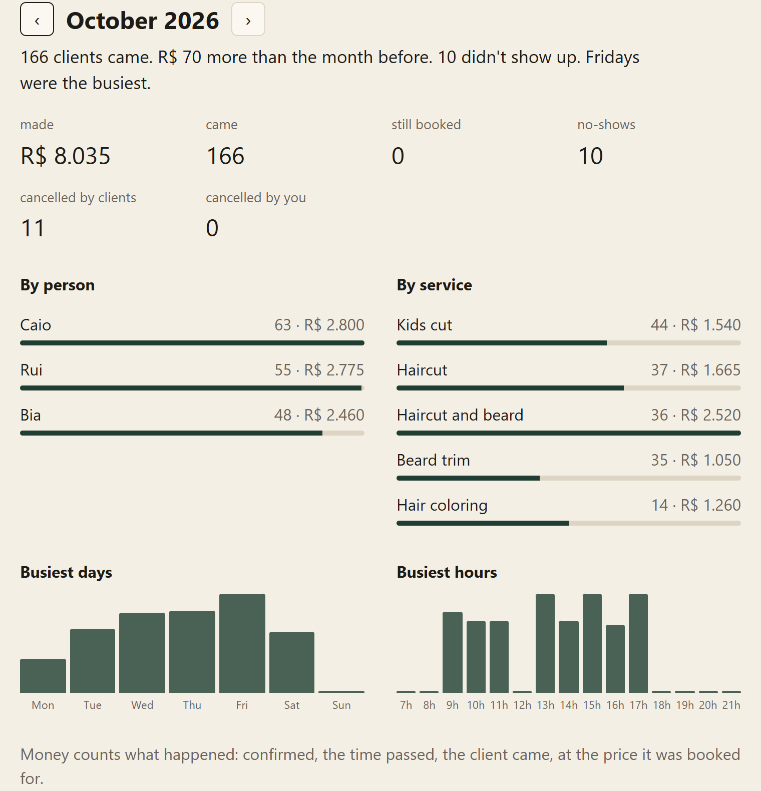

## Who's this client?

On the agenda, a client's name opens a line about them, found by their phone number: how many times they came and when they were last in, what they usually have, how much they've spent there, and how often they didn't show up or cancelled. *"Came 14 times, last on 11 Nov (Haircut and beard). Usually haircut and beard, since 1 Sept. R$ 705 so far."* A regular gets treated like one, and someone who skipped twice gets a red line on the side, so it's worth a call the day before.

People type their phone in every shape, `(11) 98888-7777`, `11988887777`, `+55 11 98888-7777`, so the match is on the last 11 digits only. There are no client accounts for this to hang on: the phone is the one thing everyone gives the same way.

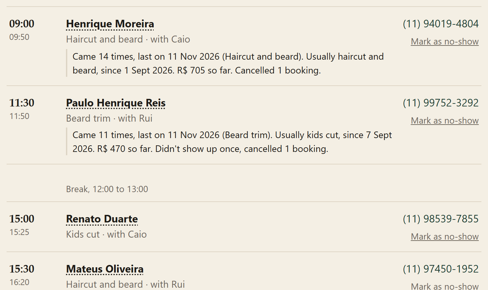

## The rules

`BookingRules.check` takes a calendar, a service and a start time, and returns every reason the time is refused (empty list = it can be booked):

| Problem | Example |
|---|---|
| in the past / too soon | booking at 07:30 for 09:00 with 2 hours of notice required |
| too far ahead | the calendar only opens 60 days ahead |
| closed that day | Sunday, or a holiday set just for that date |
| outside working hours | a 30 min haircut at 17:45 when it closes at 18:00 |
| runs into a break | 11:45 when lunch is 12:00-13:00 |
| off the grid | 09:07 when appointments start every 15 minutes |
| professional is away | a doctor's appointment, vacation |
| clashes with a booking | including the cleanup time after the other client |

It returns all of them at once instead of stopping at the first, so the screen can say everything that's wrong.

Some decisions:

- Times are half-open, `[start, end)`. A booking that ends at 10:00 and another that starts at 10:00 don't clash.
- The buffer after a service (cleaning, notes) blocks the next client but is allowed to run past closing. A haircut at 17:30 ends at 18:00 and the cleanup happens with the door closed.
- A lunch break is just the gap between two ranges of the day (`09:00-12:00` and `13:00-18:00`), not a separate concept.
- A specific date can replace its weekday, like a Saturday before a holiday that only opens in the morning. With no ranges, that date is closed.
- The slot grid counts from the start of each range, so after lunch the first slot is 13:00 even if the morning started at 08:45.

`Availability.freeSlots` walks the grid of each range of the day and keeps the times that pass `BookingRules.check`. Same check, not a second copy of the rules, so a time that shows up as free is always accepted when the client books it (there's a test that books every offered slot to make sure).

## Two clients, same time, same second

The rules check the calendar and then the booking is saved. Between those two steps another request can sneak in and book the same time, and both would pass the check.

So the database has the last word. The `booking` table has an exclusion constraint:

```sql
CONSTRAINT booking_no_overlap EXCLUDE USING gist (
    professional_id WITH =,
    tsrange(starts, blocked_until, '[)') WITH &&
) WHERE (status = 'CONFIRMED')
```

Postgres refuses any confirmed booking whose time range overlaps another one *with the same person*, buffer included. Rui at 10:00 and Bia at 10:00 are fine; Rui twice at 10:00 isn't. Mixing `=` on a plain column with `&&` on a range in one constraint needs the `btree_gist` extension. The API turns that error into the same 409 the rules give. There's a test that fires 8 bookings for the same time at once: one gets in, seven get `CLASHES_WITH_BOOKING`, and the table ends up with one row. With enough of them at once, Postgres can also find two inserts waiting on each other's overlap check and stop one of them with a deadlock. That one simply tries again, and then finds the time taken like the others. Cancelled bookings are left out of the constraint, so cancelling frees the time.

A booking also copies its end and buffer when it's saved, so making a service longer later doesn't move the appointments that already exist.

## API

Client side:

| | |
|---|---|
| `GET /api/business` | name, address, opening hours, current time |
| `GET /api/services` | active services |
| `GET /api/availability?serviceId=1&date=2026-11-03` | free times of a day |
| `GET /api/availability/days?serviceId=1&from=2026-11-02&count=14` | how each day looks, in one go |
| `POST /api/bookings` | `{"serviceId":1,"start":"2026-11-03T10:00","clientName":"Ana","clientPhone":"(11) 98888-7777"}` |
| `GET /api/bookings/by-token/{token}` | the booking from the cancel link, without the phone |
| `POST /api/bookings/by-token/{token}/cancel` | cancels it, 409 if it's too late or already cancelled |
| `POST /api/bookings/by-token/{token}/move` | `{"start": "..."}`, same person and service; 409 if that time isn't free or it's too late |
| `GET /api/bookings/by-token/{token}/calendar.ics` | the booking for a calendar app, with two reminders |
| `POST /api/waiting` | `{"serviceId":1,"date":"2026-11-14","clientName":"Lucas","clientPhone":"..."}`, answers `{"place": 1}` |

A refused booking answers 409 with the reasons:

```json
{
  "error": "This time can't be booked",
  "problems": [{ "code": "CROSSES_BREAK", "message": "The appointment would run into a break." }]
}
```

Staff side, under `/api/admin` (needs the login): create and edit services, set the week's hours, special dates, time off, the day's bookings, the day's waiting list (`GET /api/admin/waiting?date=`, `DELETE /api/admin/waiting/{id}`), marking a reminder as sent (`POST /api/admin/bookings/{id}/reminded`), a no-show (`POST /api/admin/bookings/{id}/no-show`), the month's report (`GET /api/admin/report?month=2026-10`), one client's history (`GET /api/admin/clients?phone=11988887777`), and the team (who does which services, and each person's own week at `PUT /api/admin/professionals/{id}/hours`, where `{}` means the place's hours). Login is `POST /api/auth/login`, `POST /api/auth/logout` and `GET /api/auth/me`; a call without a session gets 401, a change without the CSRF token gets 403.

`/availability/days` loads two weeks of hours, time off and bookings in a handful of queries and works out the days in memory, instead of one round of queries per day. The bookings are looked up by time window, with a partial index on `starts` for confirmed bookings only.

## Running it

Java 21, Spring Boot 4 and Maven. The tests start their own PostgreSQL (embedded, downloaded by Maven the first time), so there's nothing to install or Docker to run:

```bash
mvn test
```

To click around the page with a barbershop already set up and some times taken, on the same embedded Postgres:

```bash
mvn test-compile spring-boot:test-run -Dspring-boot.test-run.main-class=io.github.viniciusclemos.booking.DemoApplication
```

Then open http://localhost:8080. The staff page is http://localhost:8080/admin.html, with `rui@northside.test` / `northside-demo`. Everything is gone when it stops.

Against a real database, set `DB_URL`, `DB_USER`, `DB_PASSWORD`, `OWNER_EMAIL` and `OWNER_PASSWORD` and run `mvn spring-boot:run`. Flyway creates the tables. The business's rules (timezone, notice, how far ahead, slot grid) are in `application.properties`.

## Putting it online

It runs on Render's free plan, as a Docker service (`render.yaml` + `Dockerfile`), with the database on a free [Neon](https://neon.tech) Postgres, since Render's free database is deleted after 30 days.

1. Create a project on Neon and copy the JDBC connection string (`jdbc:postgresql://...?user=...&password=...&sslmode=require`).
2. On Render, New > Blueprint, pick this repo and paste that string in `DB_URL`.

`BOOKING_DEMO=true` (already in the blueprint) makes it the public demo: the barbershop set up, the staff login shown on the staff page, and bookings topped up every night. For a real business, leave it off and set `OWNER_EMAIL` and `OWNER_PASSWORD` instead.

The free instance sleeps after 15 minutes without visits, so the first page after that takes a while (Spring needs about half a minute to start).

## How the code is split

```
domain/       TimeRange, Interval, ServiceOffering, Booking, WeeklySchedule, BookingPolicy, Calendar
scheduling/   BookingRules, Availability (pure Java, no Spring), SchedulingService
store/        SQL with JdbcClient
api/          controllers and error responses
auth/         staff login, session and CSRF setup, the lock after wrong passwords
```

The rules don't know about Spring or the database, which is why most of the tests run in milliseconds.

## What's next

- a reminder to the client by message the day before, with the link
- the client seeing their own bookings from the phone number, without an account (the staff side already looks people up this way)
