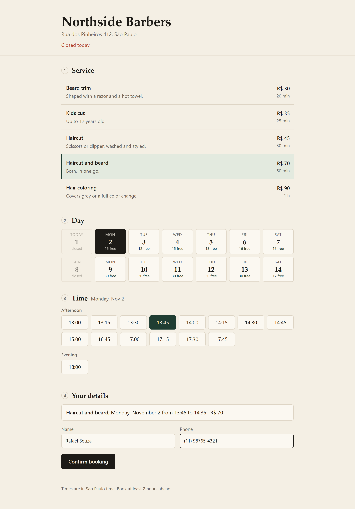
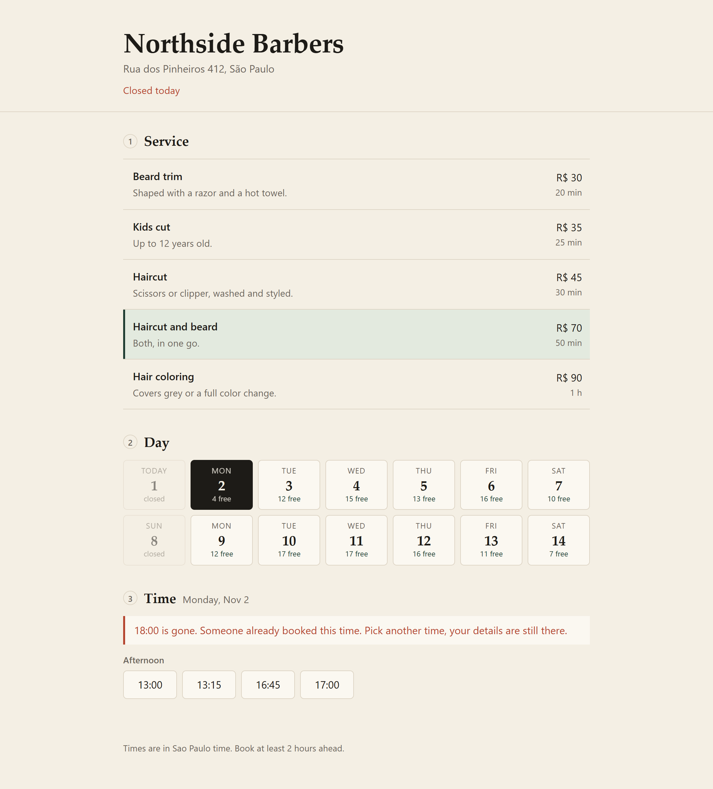
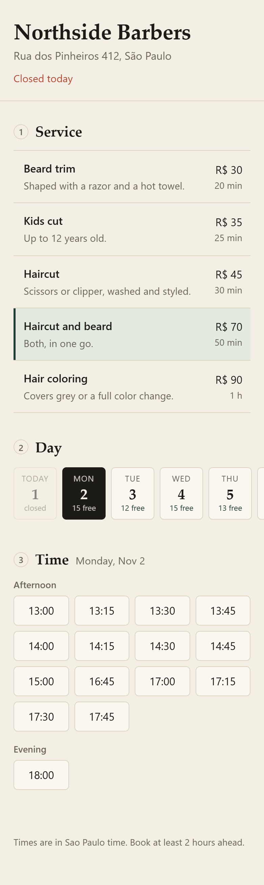
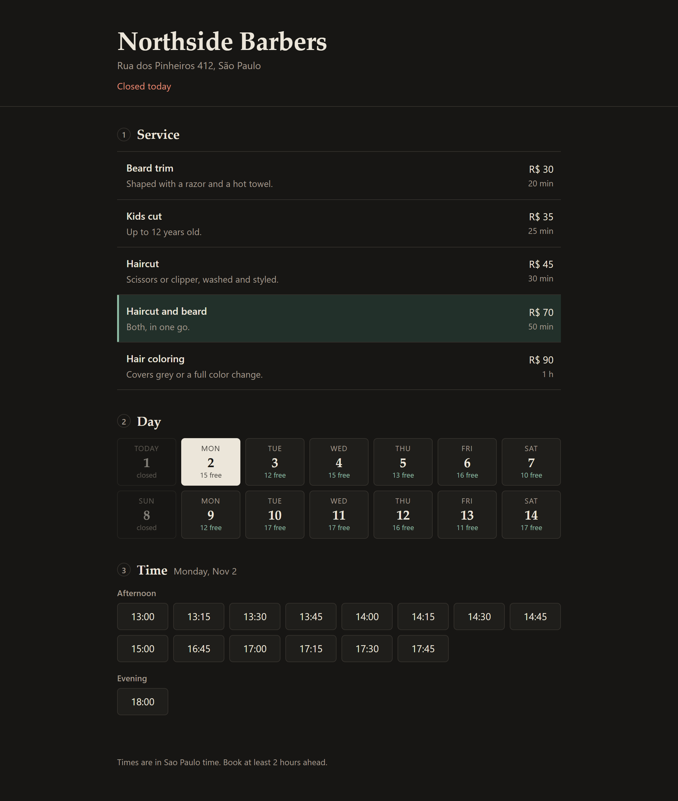
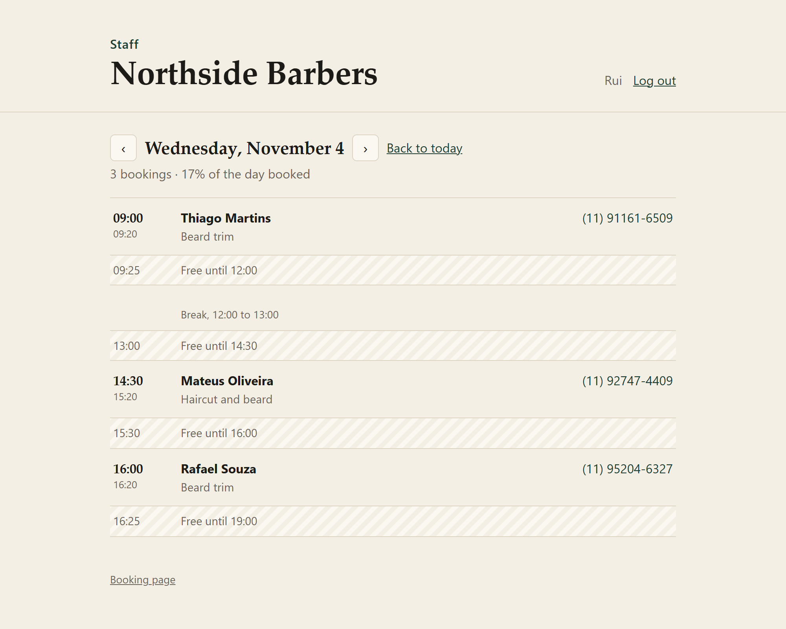
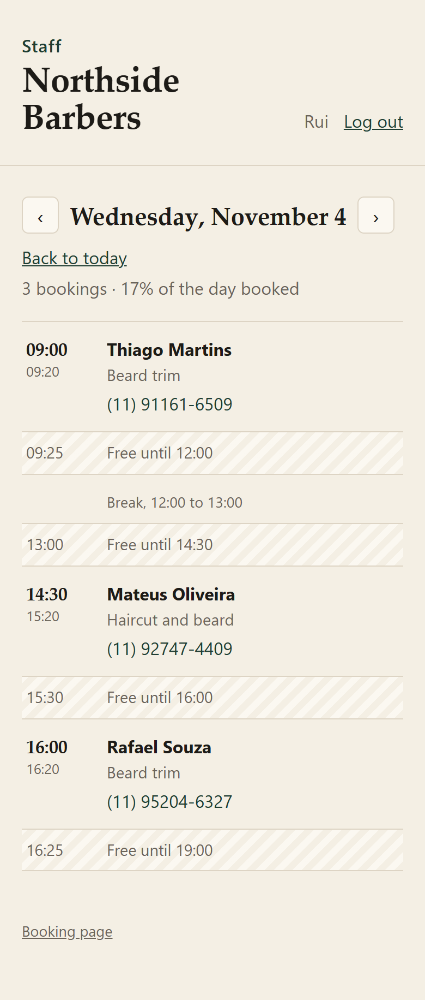

# Booking System


Online booking for small businesses like a barbershop, a clinic or a nail salon: the business sets up its services and opening hours, and clients pick a free time.

Building a form that saves a date is easy. The hard part is the rules: two clients can't get the same time, a 30 minute haircut can't start at 11:45 if lunch is at 12:00, the barber needs 10 minutes to clean up between clients, nobody can book for 5 minutes from now. That's the part I wanted to get right first, then the API and the page on top of it.



Work in progress. What works today: the rules, a REST API on PostgreSQL, the client's booking page and a staff page with login. Cancelling and more than one professional come next.

## The booking page

Pick a service, a day, a time, write your name and phone, done. Each day shows how many times are still free, so a client doesn't click through full days. Times are split into morning, afternoon and evening.

If someone else takes the same time while the page is open, the booking is refused, the list of times is reloaded and the page says what happened, keeping the name and phone already typed:



It's plain HTML, CSS and JS served by Spring (`src/main/resources/static`), no build step. Follows the system's dark mode and works on a phone, where the days become a strip you swipe sideways.

<p>
  
  
</p>

## The staff side

`/admin.html` is where the barber logs in and sees the day: each booking with the client's phone (a tap calls it on the phone), and the free time between them, so it's easy to see where a walk-in fits.

<p>
  
  
</p>

How the login works:

- E-mail and password, checked against a bcrypt hash. The answer is the same for an unknown e-mail and a wrong password, so the login can't be used to find out who works there.
- After logging in, the browser gets a session cookie marked `HttpOnly` (a script on the page can't read it) and `SameSite=Strict`. The session id changes at login, so an id planted before doesn't work after.
- Since the browser sends that cookie by itself, every change also needs a CSRF token: it comes in the `XSRF-TOKEN` cookie and the page sends it back in a header. Another site can make the browser send the cookie, but it can't read the token. The client's booking doesn't need it, there's no session there to abuse.
- 5 wrong passwords for the same e-mail lock that e-mail for 15 minutes. Other people can still log in.
- There's no default password. The first login is created from `OWNER_EMAIL` and `OWNER_PASSWORD` (at least 10 characters) when the staff table is empty; without them the app starts with no admin and says so in the log.

I went with a session instead of a JWT because the page and the API are on the same site: a cookie the page can't touch is safer than a token stored in JavaScript, and logging out actually ends the session on the server.

## The rules

`BookingRules.check` takes a calendar, a service and a start time, and returns every reason the time is refused (empty list = it can be booked):

| Problem | Example |
|---|---|
| in the past / too soon | booking at 07:30 for 09:00 with 2 hours of notice required |
| too far ahead | the calendar only opens 60 days ahead |
| closed that day | Sunday, or a holiday set just for that date |
| outside working hours | a 30 min haircut at 17:45 when it closes at 18:00 |
| runs into a break | 11:45 when lunch is 12:00-13:00 |
| off the grid | 09:07 when appointments start every 15 minutes |
| professional is away | a doctor's appointment, vacation |
| clashes with a booking | including the cleanup time after the other client |

It returns all of them at once instead of stopping at the first, so the screen can say everything that's wrong.

Some decisions:

- Times are half-open, `[start, end)`. A booking that ends at 10:00 and another that starts at 10:00 don't clash.
- The buffer after a service (cleaning, notes) blocks the next client but is allowed to run past closing. A haircut at 17:30 ends at 18:00 and the cleanup happens with the door closed.
- A lunch break is just the gap between two ranges of the day (`09:00-12:00` and `13:00-18:00`), not a separate concept.
- A specific date can replace its weekday, like a Saturday before a holiday that only opens in the morning. With no ranges, that date is closed.
- The slot grid counts from the start of each range, so after lunch the first slot is 13:00 even if the morning started at 08:45.

`Availability.freeSlots` walks the grid of each range of the day and keeps the times that pass `BookingRules.check`. Same check, not a second copy of the rules, so a time that shows up as free is always accepted when the client books it (there's a test that books every offered slot to make sure).

## Two clients, same time, same second

The rules check the calendar and then the booking is saved. Between those two steps another request can sneak in and book the same time, and both would pass the check.

So the database has the last word. The `booking` table has an exclusion constraint:

```sql
CONSTRAINT booking_no_overlap EXCLUDE USING gist (
    tsrange(starts, blocked_until, '[)') WITH &&
) WHERE (status = 'CONFIRMED')
```

Postgres refuses any confirmed booking whose time range overlaps another one, buffer included. The API turns that error into the same 409 the rules give. There's a test that fires 8 bookings for the same time at once: one gets in, seven get `CLASHES_WITH_BOOKING`, and the table ends up with one row. Cancelled bookings are left out of the constraint, so cancelling frees the time.

A booking also copies its end and buffer when it's saved, so making a service longer later doesn't move the appointments that already exist.

## API

Client side:

| | |
|---|---|
| `GET /api/business` | name, address, opening hours, current time |
| `GET /api/services` | active services |
| `GET /api/availability?serviceId=1&date=2026-11-03` | free times of a day |
| `GET /api/availability/days?serviceId=1&from=2026-11-02&count=14` | how each day looks, in one go |
| `POST /api/bookings` | `{"serviceId":1,"start":"2026-11-03T10:00","clientName":"Ana","clientPhone":"(11) 98888-7777"}` |
| `GET /api/bookings/{id}` | the booking, without the phone |

A refused booking answers 409 with the reasons:

```json
{
  "error": "This time can't be booked",
  "problems": [{ "code": "CROSSES_BREAK", "message": "The appointment would run into a break." }]
}
```

Staff side, under `/api/admin` (needs the login): create and edit services, set the week's hours, special dates, time off, and the day's bookings. Login is `POST /api/auth/login`, `POST /api/auth/logout` and `GET /api/auth/me`; a call without a session gets 401, a change without the CSRF token gets 403.

`/availability/days` loads two weeks of hours, time off and bookings in a handful of queries and works out the days in memory, instead of one round of queries per day. The bookings are looked up by time window, with a partial index on `starts` for confirmed bookings only.

## Running it

Java 21 and Maven. The tests start their own PostgreSQL (embedded, downloaded by Maven the first time), so there's nothing to install or Docker to run:

```bash
mvn test
```

To click around the page with a barbershop already set up and some times taken, on the same embedded Postgres:

```bash
mvn test-compile spring-boot:test-run -Dspring-boot.test-run.main-class=io.github.viniciusclemos.booking.DemoApplication
```

Then open http://localhost:8080. The staff page is http://localhost:8080/admin.html, with `rui@northside.test` / `northside-demo`. Everything is gone when it stops.

Against a real database, set `DB_URL`, `DB_USER`, `DB_PASSWORD`, `OWNER_EMAIL` and `OWNER_PASSWORD` and run `mvn spring-boot:run`. Flyway creates the tables. The business's rules (timezone, notice, how far ahead, slot grid) are in `application.properties`.

## How the code is split

```
domain/       TimeRange, Interval, ServiceOffering, Booking, WeeklySchedule, BookingPolicy, Calendar
scheduling/   BookingRules, Availability (pure Java, no Spring), SchedulingService
store/        SQL with JdbcClient
api/          controllers and error responses
auth/         staff login, session and CSRF setup, the lock after wrong passwords
```

The rules don't know about Spring or the database, which is why most of the tests run in milliseconds.

## What's next

- cancelling, with a deadline (up to X hours before), from a link the client gets
- several professionals, each with their own calendar
- editing services and hours from the staff page (today it's only through the API)
